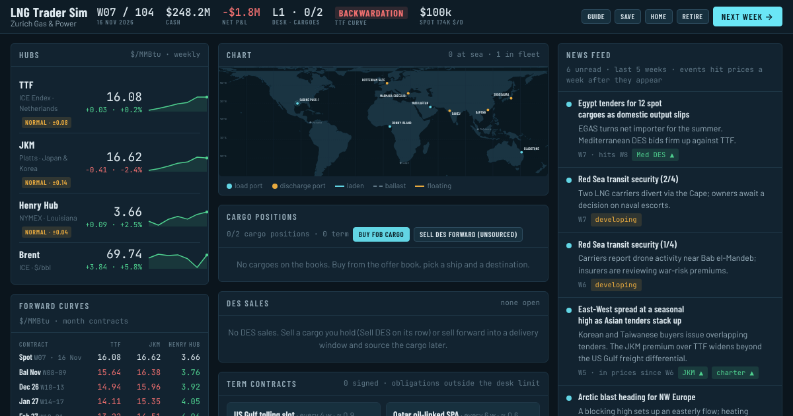

# LNG Trader Sim

A browser game of physical LNG trading. Run a trading desk for 104 weeks: buy FOB cargoes from a weekly offer book at Sabine Pass, Ras Laffan, Gladstone and Bonny, charter steam, TFDE and two-stroke ships on term or spot, route them through Panama, Suez or the Cape, sell DES into delivery windows, sign term contracts and hedge on TTF and JKM month contracts.

**Play it:** https://mcp10.github.io/lng-trader-game/



## What is modelled

- **Markets.** TTF, JKM, Henry Hub and Brent with seasonal shape, mean reversion, regimes and EU storage. Monthly forward curves, hub liquidity that thins when the tape is volatile, and slippage on size.
- **Cargoes.** FOB markers off the marginal buyer's netback (Atlantic ports off Europe, Pacific ports off Asia), tenders with laycans, DES markers by discharge port, two-week delivery windows.
- **Shipping.** Term and spot charters, hire that runs idle or not, positioning, boil-off as fuel on the laden leg and heel burn in ballast, canal tolls, closures and delays, diversions from the ship's position, floating storage.
- **Contracts.** A US Gulf tolling slot, a take-or-pay Qatar SPA and an oil-indexed Japan term sale, with terms struck at signing and their own cancellation rules.
- **Paper.** TTF and JKM month contracts with initial margin, margin calls and bid-offer, settled on the month's average.
- **News.** Events hit prices a week after they appear, so the feed is the edge.

Everything is stylised and synthetic. It is a game, not a forecast and not advice.

## Repository

```
index.html        the game, built from src/ (do not edit by hand)
fonts/            self-hosted Barlow, Barlow Condensed and JetBrains Mono (OFL), no third-party requests
og.png            link preview image, favicon.svg
src/head.html     styles (dark and light themes)
src/body.html     screens and panels
src/land.js       world land outline (Natural Earth via world-atlas, built by tools/mkland.js)
src/model.js      market, fleet, cargo, contract and hedge model, weekly step, save and migration
src/ui.js         rendering, dialogs and the click dispatcher
tools/build.sh    assembles index.html and dist/artifact.html
tools/test/       bot simulation, jsdom click-through and hedge audit
tools/shots.py    Playwright screenshots (preview image and phone views)
```

## Build and test

Plain JavaScript, no bundler. Node 18+ and `npm install jsdom` for the DOM test.

```sh
tools/build.sh                                   # writes index.html
node tools/test/dom_test2.js index.html          # click-through of every dialog, expects errors: []
cat src/model.js tools/test/test2.js > /tmp/bot.js && node /tmp/bot.js        # bot plays 16 games, prints medians
cat src/model.js tools/test/hedge_audit.js > /tmp/ha.js && node /tmp/ha.js    # hedged vs unhedged P&L spread
```

To host under your own domain, set `SITE_URL` when building so the canonical and preview tags point at it: `SITE_URL=https://example.com/ tools/build.sh`.

## Hosting

The site is static: `index.html`, `fonts/`, `og.png` and `favicon.svg` are all it needs.

- **Netlify.** Import the repo (`netlify.toml` sets publish directory `.` and no build command), or drag the four items above onto app.netlify.com/drop.
- **GitHub Pages.** Settings, Pages, Source: Deploy from a branch, Branch: master / (root).

Every push to `master` redeploys on either.

Saved games live in the player's browser (`localStorage`) and are tied to the domain.

## Credits and licence

Code: MIT, see `LICENSE`. Map outline: [Natural Earth](https://www.naturalearthdata.com/) (public domain) via [world-atlas](https://github.com/topojson/world-atlas). Fonts: Barlow and Barlow Condensed by Jeremy Tribby, JetBrains Mono by JetBrains, both under the SIL Open Font License 1.1 (`fonts/`).
